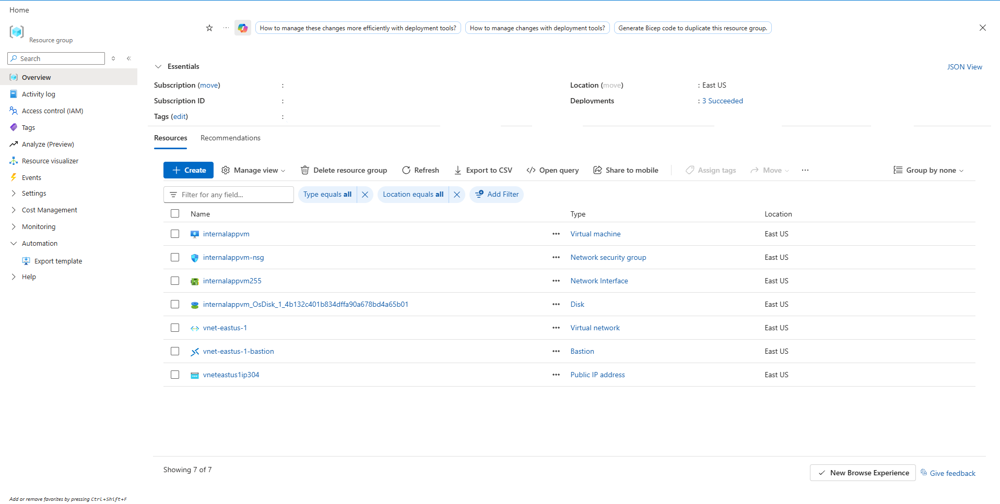
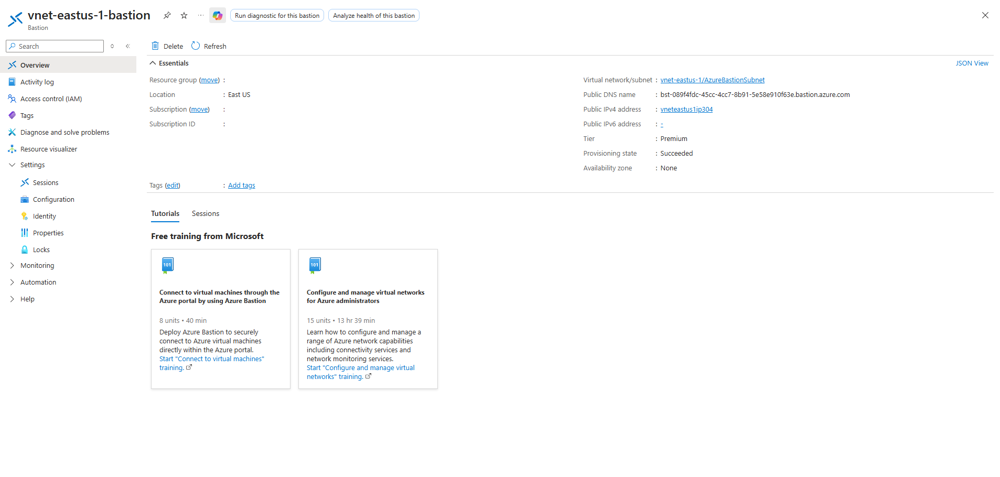
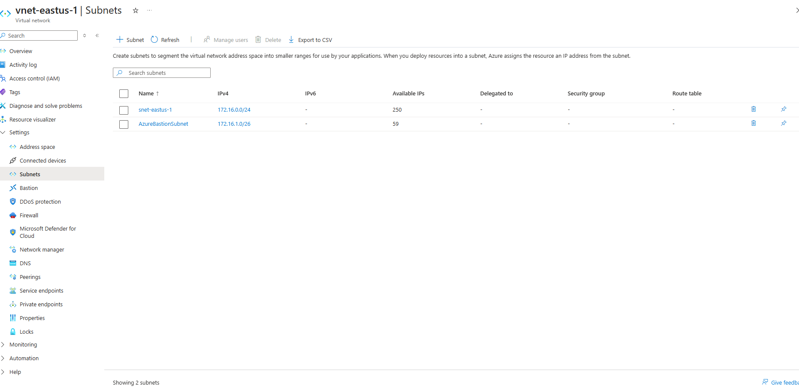
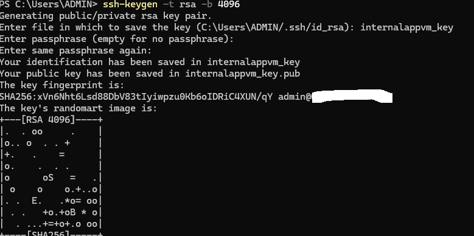
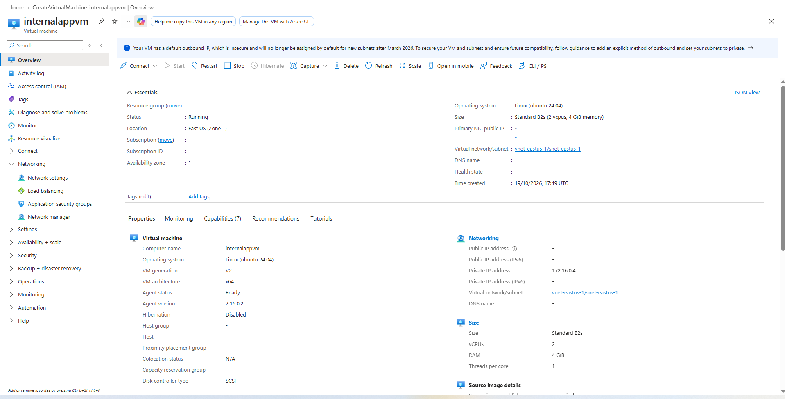
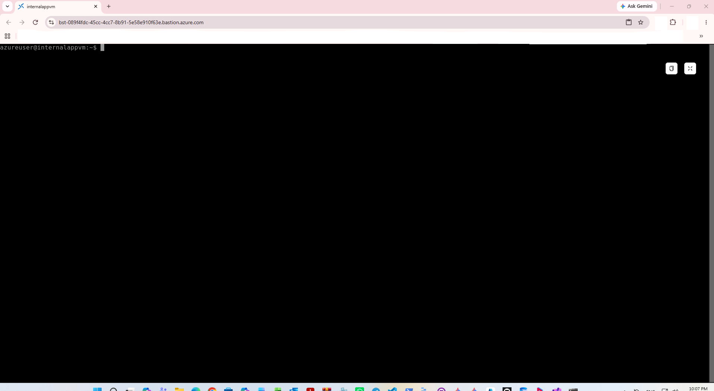

# Managing Virtual Machines with Azure Bastion

Comprehensive infrastructure provisioning details covering the setup, configuration, and secure browser-based management of a private Linux virtual machine using Azure Bastion Host and SSH public key authentication.

---

## 1. Architecture & Provisioned Resources

### Core Infrastructure Topology

| Resource Type | Resource Name | Specification / Tier | Region / Location |
| :--- | :--- | :--- | :--- |
| **Virtual Machine** | `internalappvm` | Standard_B2s, Ubuntu 24.04 LTS (Trusted Launch) | East US (Zone 1) |
| **Virtual Network** | `vnet-eastus-1` | `172.16.0.0/16` Address Space | East US |
| **Workload Subnet** | `snet-eastus-1` | `172.16.0.0/24` Address Prefix | East US |
| **Bastion Subnet** | `AzureBastionSubnet` | `172.16.1.0/26` Address Prefix | East US |
| **Azure Bastion Host** | `vnet-eastus-1-bastion` | Premium Tier, 2 Scale Units | East US |
| **Bastion Public IP** | `vneteastus1ip304` | Static Standard IPv4 (`40.114.118.102`) | East US |
| **Network Security Group** | `internalappvm-nsg` | Associated with `internalappvm255` NIC | East US |

---

### Provisioned Environment Validation

*Resource group overview confirming successful provisioning of the private virtual machine, network security group, network interface, OS disk, virtual network, Azure Bastion host, and public IP address.*[cite: 26]

---

*Azure Bastion host overview pane displaying host settings, Premium tier configuration, and associated public IP address.*[cite: 28]

---

## 2. Step-by-Step Implementation

### Step 1: Configure Virtual Network Subnets

Created `AzureBastionSubnet` alongside `snet-eastus-1` within `vnet-eastus-1` to dedicatedly host the Azure Bastion instance.

*Virtual network subnet configuration showcasing snet-eastus-1 and AzureBastionSubnet address ranges.*[cite: 23]

---

### Step 2: Generate RSA SSH Key Pair

Generated a 4096-bit RSA SSH key pair on the local management client for secure authentication to the virtual machine.

*Creating a 4096-bit RSA key pair using ssh-keygen command in PowerShell.*[cite: 25]

---

### Step 3: Deploy Private Virtual Machine Without Public IP

Provisioned `internalappvm` on `snet-eastus-1` without assigning a public IP address, securing access exclusively through internal network interfaces.

*Virtual machine overview pane confirming running status, private IP address 172.16.0.4, and no associated public IP.*[cite: 24]

---

### Step 4: Validate Secure Connection via Azure Bastion

Established a secure, browser-based SSH session to `internalappvm` using Azure Bastion and the generated SSH private key.

*Successful terminal session established inside the Azure Portal browser interface via Azure Bastion.*[cite: 27]
